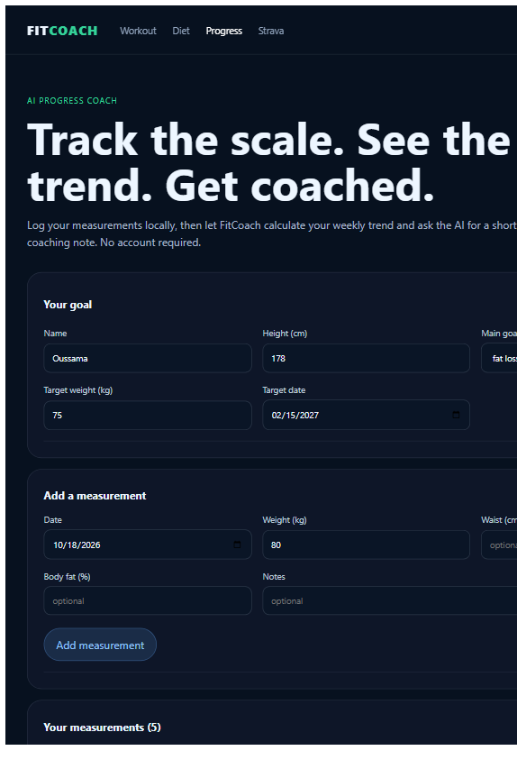
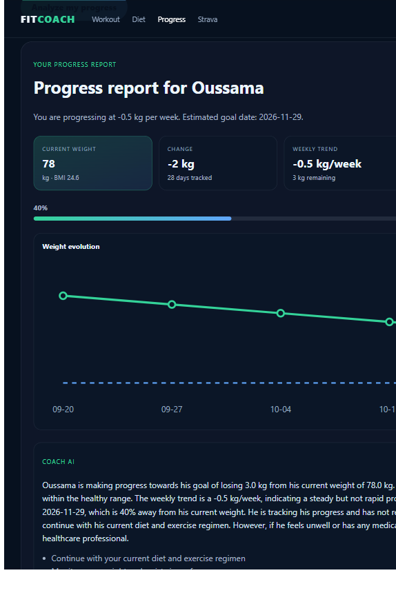
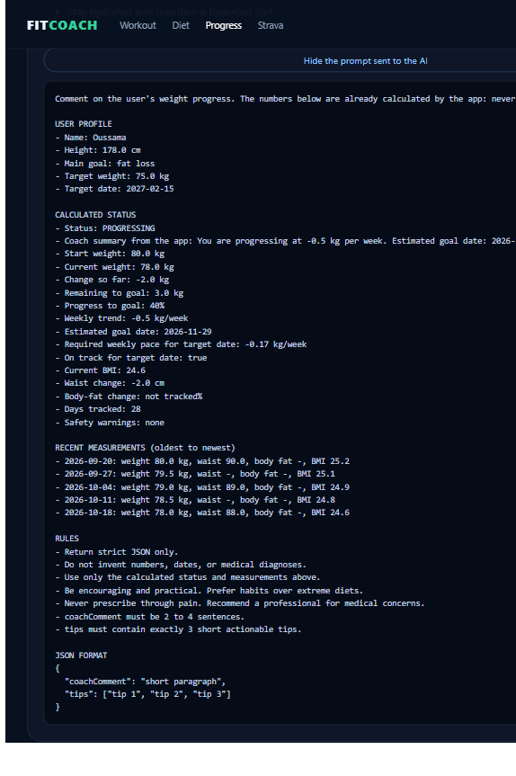
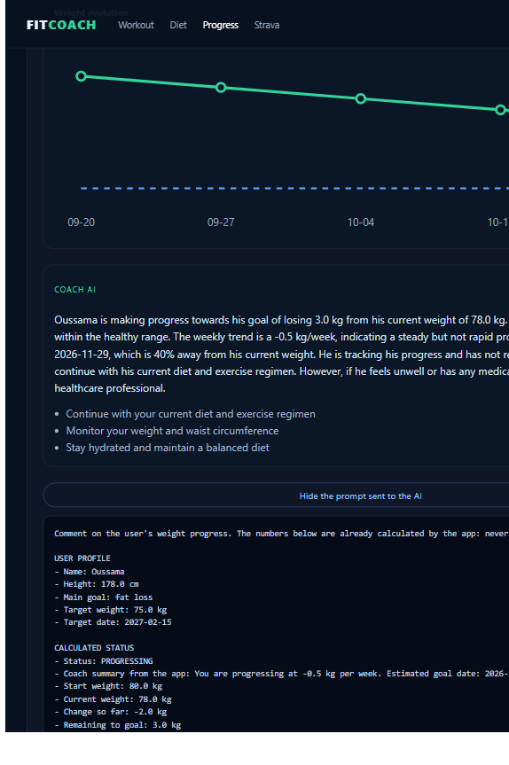

# Module « Progress IA » : suivi de progression FitCoach

## 1. Ce que j'ai ajouté

La section **Progress** était un placeholder. Elle est devenue un **suivi de progression avec analyse IA** :

| Couche | Fichier | Rôle |
|---|---|---|
| Backend | `dto/ProgressAnalysisRequest.java` | Objectif + mesures, validés avec Jakarta Validation |
| Backend | `dto/ProgressAnalysisResponse.java` | Stats, points du graphique, commentaire coach, tips, prompt |
| Backend | `service/ProgressCalculationsService.java` | Tendance (régression linéaire), date estimée, cas limites |
| Backend | `service/ProgressPromptService.java` | Construction du prompt envoyé au modèle |
| Backend | `service/AiCompletionClient.java` | Client HTTP Ollama / OpenAI (timeouts, JSON) |
| Backend | `service/ProgressAnalysisService.java` | Orchestration : calculs, appel IA, validation, fallback |
| Backend | `controller/ProgressAnalysisController.java` | `POST /api/public/progress/analyze` |
| Tests | `ProgressCalculationsServiceTest.java` | Perte, gain, stable, une mesure, objectif atteint |
| Tests | `ProgressAnalysisServiceTest.java` | JSON valide / invalide, IA indisponible |
| Frontend | `progress/progress.component.*` | Formulaire, graphique SVG, stats, coach, prompt |

### Points forts techniques

- **Les chiffres viennent du code Java**, pas de l'IA (tendance kg/semaine, date estimée, % d'objectif).
- **Cas limites gérés** : moins de 2 mesures / moins de 7 jours, poids stable, tendance qui s'éloigne, objectif atteint (±0,5 kg).
- **Sécurité** : avertissement si la perte dépasse ~1 % du poids par semaine.
- **Robustesse** : si Ollama est down ou renvoie un JSON invalide, un message de secours avec exactement 3 tips est renvoyé.
- **Transparence** : le bouton « Show the prompt sent to the AI » affiche le prompt exact.

## 2. Le prompt système envoyé au modèle

```text
You are a careful, encouraging fitness coach. You answer with strict JSON only, never markdown.
```

## 3. Le prompt utilisateur (structure)

Construit dans `ProgressPromptService`, avec 4 blocs :

1. **USER PROFILE** — nom, taille, objectif, poids cible, date cible  
2. **CALCULATED STATUS** — statut, tendance, date estimée, BMI, avertissements (chiffres déjà calculés)  
3. **RECENT MEASUREMENTS** — dernières pesées (poids, tour de taille, masse grasse, BMI)  
4. **RULES + JSON FORMAT** — ne pas inventer de chiffres, exactement 3 tips, format JSON imposé  

Le prompt complet est visible dans l'application et dans la capture `07-progress-prompt.png`.

### Techniques de prompt engineering

1. **Rôle** : coach encourageant et prudent.  
2. **Séparation calcul / langage** : « The numbers below are already calculated… never invent or change them. »  
3. **Contexte structuré** : sections claires (profil / statut / mesures / règles).  
4. **Contraintes de sortie** : JSON strict, `coachComment` 2–4 phrases, `tips` = exactement 3.  
5. **Garde-fous** : pas de diagnostic médical, préférer les habitudes.  
6. **Few-shot léger** : exemple de schéma JSON dans le prompt.  

## 4. Les 7 prompts utilisés pour développer le module

Voici les étapes sous forme de prompts, dans l'ordre de cette conversation.

### Prompt 1 : analyse

```text
Analyse le projet FitCoach (backend Spring Boot + frontend Angular). Explique-moi comment
fonctionne actuellement la page Progress : côté backend (ProgressController, ProgressService,
ProgressMeasurement) et côté frontend (frontend/src/app/progress). Dis-moi ce qui manque pour
qu'elle soit utilisable. Regarde aussi comment le module nutrition (dossiers dto/, service/,
controller/, et frontend/src/app/diet/) est structuré, car je veux m'en inspirer.
N'écris pas de code, fais seulement l'analyse.
```

### Prompt 2 : conception

```text
Je veux transformer la page Progress (actuellement un placeholder) en suivi de progression.
L'utilisateur peut ajouter une mesure (date, poids, tour de taille, % de masse grasse) et voir
l'évolution vers son poids cible. Propose la conception : endpoints REST, DTO, fichiers à créer
ou modifier, structure de la page Angular. Respecte le style du module nutrition.
N'écris pas encore de code, attends ma validation.
```

### Prompt 3 : backend (calculs)

```text
Implémente le backend du suivi de progression selon la conception validée, dans le même style
que le module nutrition (DTO validés avec Jakarta Validation, service, controller, préfixe
/api/public/progress). Ajoute un calcul de tendance fait par le backend (pas par l'IA) :
perte ou gain moyen par semaine, et estimation de la date d'atteinte du poids cible.
Gère les cas limites : moins de 2 mesures, poids stable, tendance qui s'éloigne de l'objectif.
```

### Prompt 4 : analyse IA

```text
Ajoute une analyse IA de la progression avec Ollama, comme dans le module nutrition. Envoie au
modèle les dernières mesures, l'objectif et la tendance calculée, avec un prompt structuré
(rôle, données, règles, format de sortie JSON). L'IA renvoie un commentaire de coach et exactement
3 conseils. Les chiffres viennent du backend, l'IA ne doit rien inventer. Valide et parse le JSON
reçu, et prévois un message de secours si Ollama est indisponible ou si la réponse est invalide.
Ajoute un endpoint ou un champ qui expose le prompt exact envoyé, comme sur la page Diet.
```

### Prompt 5 : tests

```text
Écris des tests unitaires JUnit 5 et Mockito pour : (1) le calcul de tendance (perte, gain,
stable, une seule mesure, objectif atteint), (2) le parsing de la réponse IA (JSON valide,
JSON invalide, IA indisponible avec message de secours). Lance les tests et corrige ce qui échoue.
```

### Prompt 6 : frontend

```text
Crée la page Angular Progress avec le même design que la page Diet : un formulaire pour ajouter
une mesure, un graphique de l'évolution du poids en SVG (sans librairie externe) avec la ligne
du poids cible, des cartes de statistiques (poids actuel, variation, tendance par semaine,
date estimée d'atteinte), et le commentaire du coach IA avec ses 3 conseils. Ajoute un bouton
qui affiche le prompt envoyé à l'IA. Gère les états de chargement et d'erreur.
```

### Prompt 7 : vérification et documentation

```text
Compile le frontend, lance tous les tests backend, démarre l'application (si Docker ne marche
pas, utilise H2 en mémoire sur des ports libres) et vérifie la page Progress dans le navigateur.
Fais des captures d'écran dans docs/screenshots/, puis crée PROMPTS_PROGRESS.md contenant : le
prompt système et le prompt envoyé à l'IA, les techniques de prompt engineering utilisées, les
7 prompts de cette conversation et les captures. Ajoute un lien vers ce fichier dans le README.md.
```

## 5. Lancer le module

```powershell
ollama serve
ollama pull qwen2.5:0.5b   # ou llama3.2:1b si assez de mémoire
# Backend (exemple H2 de démo) + frontend ng serve
```

Ouvrir `http://localhost:4200/progress` (ou le port utilisé), cliquer sur **Load sample data**, puis **Analyze my progress**, puis **Show the prompt sent to the AI**.

## 6. Captures d'écran

Captures réalisées avec le modèle local `qwen2.5:0.5b` (Ollama).

### Formulaire et mesures



### Rapport : stats, graphique SVG, tendance



### Prompt exact envoyé à l'IA



### Commentaire coach + 3 conseils


